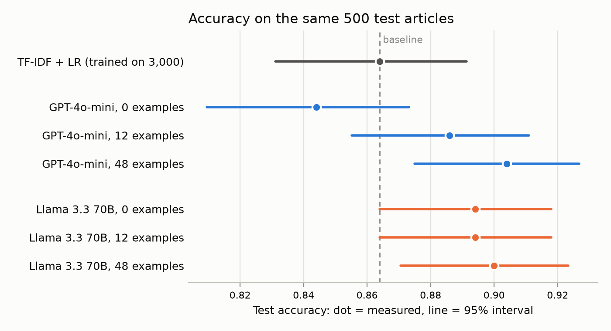

# Zero-shot and few-shot LLMs versus a small supervised model

Can two LLMs, used without any training, beat a simple TF-IDF + logistic regression classifier at sorting
news articles into four topics (World, Sports, Business, Sci/Tech)? And is the difference worth the extra
cost and latency?

## What is compared

- **TF-IDF + logistic regression**, trained on 3,000 labeled articles.
- **GPT-4o-mini** and **Llama 3.3 70B Instruct** through OpenRouter, each with 0, 12, and 48 examples in the prompt.

All seven are scored on the same 500 test articles: accuracy, macro-F1, cost per 1,000 predictions, and
mean/median latency. For each LLM we also report how much accuracy changes between 0, 12, and 48 examples.

## Results

| Model | Labeled examples | Accuracy (95% interval) | Macro-F1 | Cost per 1,000 | Latency, mean / median | Versus baseline |
|---|---|---|---|---|---|---|
| TF-IDF + LR | 3,000 (training) | 0.864 (0.831–0.891) | 0.864 | $0 | 0.44 / 0.40 ms | — |
| GPT-4o-mini | 0 | 0.844 (0.810–0.873) | 0.841 | $0.014 | 0.50 / 0.50 s | −2.0 points, p = 0.35 |
| GPT-4o-mini | 12 | 0.886 (0.855–0.911) | 0.886 | $0.12 | 0.58 / 0.58 s | +2.2 points, p = 0.22 |
| GPT-4o-mini | 48 | 0.904 (0.875–0.927) | 0.904 | $0.23 | 0.61 / 0.60 s | +4.0 points, p = 0.017 |
| Llama 3.3 70B | 0 | 0.894 (0.864–0.918) | 0.894 | $0.067 | 0.36 / 0.31 s | +3.0 points, p = 0.10 |
| Llama 3.3 70B | 12 | 0.894 (0.864–0.918) | 0.894 | $0.37 | 0.45 / 0.38 s | +3.0 points, p = 0.086 |
| Llama 3.3 70B | 48 | 0.900 (0.871–0.923) | 0.900 | $1.25 | 0.79 / 0.60 s | +3.6 points, p = 0.038 |



- **Accuracy.** Five of the six LLM configurations score 2.2 to 4.0 points above the baseline; GPT-4o-mini
  without examples scores 2.0 below. With 500 test articles each accuracy is uncertain by about ±3 points,
  and every LLM interval overlaps the baseline's. A paired test on the same articles (McNemar's exact test, which looks only
  at the articles exactly one of the two models got right) puts the two 48-example configurations below
  p = 0.05, but six configurations are tested, and after a Holm correction for six tests none stays below
  0.05. The LLMs' advantage is a few points at most, and this test set is too small to establish it firmly.
- **Examples in the prompt.** They matter for GPT-4o-mini: accuracy rises 6.0 points from 0 to 48 examples,
  mostly on Sci/Tech, whose F1 goes from 0.720 to 0.874. Llama 3.3 70B moves only 0.6 points, while its
  cost per prediction grows about 19-fold.
- **Topics.** Sports is the easiest topic for every model. Business and Sci/Tech, which overlap
  (technology companies' earnings, for instance), are the hardest.
- **Cost and latency.** The baseline trains in 0.2 s, costs nothing to run, and answers in under half a
  millisecond on a CPU. An LLM answer takes 0.36 to 0.79 s on average, about a thousand times longer, and
  costs $0.014 to $1.25 per 1,000 articles.

LLM latency is measured from the client and includes the network round trip. OpenRouter sent the Llama calls
to five providers (Cloudflare, Amazon Bedrock, CoreWeave, Groq, DeepInfra), so its latency and cost reflect
that mix; each prediction file records which provider answered. GPT-4o-mini was always served by OpenAI.
The full LLM run of 3,000 calls cost $1.02.

All tables, F1 per topic, the paired test's counts, and what every column in `results/` means:
[results/results.md](results/results.md).

## Setup

Requires Python 3.13.

```
python -m venv .venv
.venv\Scripts\activate        # macOS/Linux: source .venv/bin/activate
pip install -r requirements.txt
copy .env.example .env        # macOS/Linux: cp .env.example .env
```

Then put your [OpenRouter](https://openrouter.ai) API key in `.env`. Git ignores this file.

## How to run

From the repository root, with the environment activated:

```
python -m src.baseline_tfidf_logreg --score-test   # logistic regression, results in results/baseline/
python -m src.llm_classify                         # both LLMs, results in results/llm/
python -m src.compare_generated_results            # all seven side by side, results in results/
```

The dataset downloads automatically on the first run. The first two commands each write one file of
predictions per model (one row per test article) and a `test_results.csv` with the scores. The LLM run
makes 3,000 API calls; if it stops, run it again and it continues where it left off. The last command reads
those outputs, so run it after the other two.

## Data

- **AG News** from Hugging Face ([`fancyzhx/ag_news`](https://huggingface.co/datasets/fancyzhx/ag_news),
  Zhang, Zhao & LeCun, 2015), pinned to one version and checked by SHA-256. Used for non-commercial
  research only, as the original corpus requires.
- **A fixed subset** of 3,000 training, 500 validation, and 500 test articles, balanced across the four
  topics, with duplicate articles removed. The row IDs are in `data/splits/`.
- **The prompts** are in `data/prompts/`. Their examples are the first 12 and 48 training articles, the
  only article text stored in the repository.

How the subset was built: [docs/data_preparation.md](docs/data_preparation.md).

## Repository structure

```
data/splits/     Row IDs of the training, validation, and test articles
data/prompts/    LLM prompts with 0, 12, and 48 examples
src/             Code: data loading, baseline, LLM runs, comparison, shared metrics
results/         Comparison of all seven; baseline/ and llm/ hold each run's outputs
docs/            How the data subset was built
```
