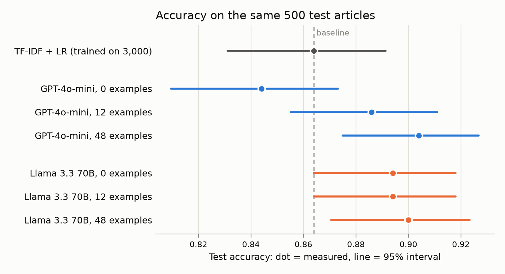

# Results

All seven configurations were scored on the same 500 test articles. The tables below are the CSV files
in this folder, rounded. They keep the CSV column names, and each table is followed by what its columns
mean. The CSV files and the chart are produced by `python -m src.compare_generated_results`.

## How to read the chart

Each row is one configuration.

- **Dot**: the accuracy measured on the 500 test articles.
- **Horizontal line**: the 95% interval around that accuracy. The 500 test articles are a sample, and
  another 500 would give a somewhat different accuracy. The line spans the range where the
  configuration's true accuracy, on news articles like these in general, most likely lies. The baseline,
  for example, measured 0.864, and its interval runs from 0.831 to 0.891. (Formally: if the test were
  repeated on many new sets of 500 articles, 95% of the intervals computed this way would contain the
  true accuracy.)
- **Dashed vertical line**: the baseline's accuracy, to read each LLM configuration against.

When two lines overlap, the test set alone cannot tell those two configurations apart, and every LLM
line overlaps the baseline's. The paired test in `test_vs_baseline.csv` (below) compares each LLM
configuration with the baseline more sharply, because it looks at the same articles for both.

## Overall scores: `test_comparison.csv`

| model | labeled_examples | n | accuracy | accuracy_ci_low | accuracy_ci_high | macro_f1 | invalid | cost_per_1000_usd | latency_mean_s | latency_median_s |
|---|---|---|---|---|---|---|---|---|---|---|
| TF-IDF + LR | 3000 | 500 | 0.864 | 0.831 | 0.891 | 0.864 | 0 | 0.000 | 0.00044 | 0.00040 |
| gpt-4o-mini | 0 | 500 | 0.844 | 0.810 | 0.873 | 0.841 | 0 | 0.014 | 0.502 | 0.498 |
| gpt-4o-mini | 12 | 500 | 0.886 | 0.855 | 0.911 | 0.886 | 0 | 0.120 | 0.576 | 0.581 |
| gpt-4o-mini | 48 | 500 | 0.904 | 0.875 | 0.927 | 0.904 | 0 | 0.227 | 0.614 | 0.600 |
| llama-3.3-70b | 0 | 500 | 0.894 | 0.864 | 0.918 | 0.894 | 0 | 0.067 | 0.355 | 0.306 |
| llama-3.3-70b | 12 | 500 | 0.894 | 0.864 | 0.918 | 0.894 | 0 | 0.371 | 0.451 | 0.380 |
| llama-3.3-70b | 48 | 500 | 0.900 | 0.871 | 0.923 | 0.900 | 0 | 1.247 | 0.787 | 0.601 |

| Column | Meaning |
|---|---|
| model | `TF-IDF + LR` is the baseline: TF-IDF word features and logistic regression. `gpt-4o-mini` and `llama-3.3-70b` are the LLMs (Llama 3.3 70B Instruct), called through OpenRouter. |
| labeled_examples | Labeled articles the configuration saw: the training articles for the baseline, the examples in the prompt for an LLM. |
| n | Test articles scored. |
| accuracy | Share of test articles given the correct topic, from 0 to 1. |
| accuracy_ci_low, accuracy_ci_high | Lower and upper ends of the 95% interval around accuracy (Wilson interval): the horizontal line in the chart. |
| macro_f1 | The F1 score of each of the four topics, averaged with equal weight. A topic's F1 combines its precision (of the articles predicted as that topic, the share that truly are) and its recall (of the articles truly of that topic, the share predicted as it): 2 × precision × recall / (precision + recall). |
| invalid | LLM answers that named none of the four topics. They count as wrong. |
| cost_per_1000_usd | Cost of 1,000 predictions in US dollars, from the average cost per call billed by OpenRouter. 0 for the baseline, which runs locally. |
| latency_mean_s, latency_median_s | Average and median time to classify one article, in seconds. For an LLM, one API call including the network round trip; for the baseline, one prediction on the CPU. |

## Scores per topic: `test_per_class_f1.csv`

| model | labeled_examples | World | Sports | Business | Sci/Tech |
|---|---|---|---|---|---|
| TF-IDF + LR | 3000 | 0.871 | 0.909 | 0.852 | 0.823 |
| gpt-4o-mini | 0 | 0.890 | 0.961 | 0.794 | 0.720 |
| gpt-4o-mini | 12 | 0.889 | 0.964 | 0.848 | 0.842 |
| gpt-4o-mini | 48 | 0.903 | 0.968 | 0.871 | 0.874 |
| llama-3.3-70b | 0 | 0.905 | 0.972 | 0.855 | 0.844 |
| llama-3.3-70b | 12 | 0.892 | 0.972 | 0.865 | 0.846 |
| llama-3.3-70b | 48 | 0.892 | 0.976 | 0.870 | 0.862 |

| Column | Meaning |
|---|---|
| model, labeled_examples | The configuration, as in `test_comparison.csv`. |
| World, Sports, Business, Sci/Tech | F1 score for that topic, from 0 to 1 (see macro_f1 above). The four average to macro_f1. |

Sports is the easiest topic for every configuration, and Business and Sci/Tech the hardest. GPT-4o-mini's
low accuracy without examples comes mostly from Sci/Tech (0.720), which rises to 0.874 with 48 examples.

## Each LLM configuration against the baseline: `test_vs_baseline.csv`

| model | labeled_examples | points_above_baseline | only_llm_correct | only_baseline_correct | p_value |
|---|---|---|---|---|---|
| gpt-4o-mini | 0 | -2.0 | 41 | 51 | 0.348 |
| gpt-4o-mini | 12 | 2.2 | 39 | 28 | 0.222 |
| gpt-4o-mini | 48 | 4.0 | 42 | 22 | 0.017 |
| llama-3.3-70b | 0 | 3.0 | 44 | 29 | 0.101 |
| llama-3.3-70b | 12 | 3.0 | 41 | 26 | 0.086 |
| llama-3.3-70b | 48 | 3.6 | 43 | 25 | 0.038 |

| Column | Meaning |
|---|---|
| model, labeled_examples | The LLM configuration compared with the baseline. |
| points_above_baseline | Its accuracy minus the baseline's, in percentage points. Negative means below the baseline. |
| only_llm_correct | Test articles the LLM got right and the baseline got wrong. |
| only_baseline_correct | Test articles the baseline got right and the LLM got wrong. |
| p_value | McNemar's exact test: the probability of a split between the two counts at least this uneven if both were equally accurate. Articles both got right, or both got wrong, do not enter it. |

A p-value below 0.05 is the usual threshold for calling a difference real, and only the two 48-example
configurations reach it. But six configurations are compared with the baseline, which makes a low
p-value by chance more likely. The stricter Holm correction keeps the overall chance of a false finding
at 5%: the smallest p-value must be below 0.05 / 6 ≈ 0.0083, the next below 0.05 / 5, and so on. The
smallest here is 0.017, so after the correction none of the differences is established.

## Files of each run

### `baseline/`

- `test_predictions.csv`: one row per test article. id (row in the AG News test file), true_label,
  predicted_label, confidence (probability the model gave its predicted topic), latency_s, cost_usd.
- `test_results.csv`: the baseline's row of `test_comparison.csv` without the interval, plus
  training_time_s (seconds to train on the 3,000 training articles) and cpu (the processor it ran on).
- `confusion_matrix_test.png`, `confusion_matrix_validation.png`: rows are the true topic, columns the
  predicted topic; the diagonal holds the correct answers.
- `validation_grid.csv`: every setting tried on the validation split, best first; the first row is the
  one used. ngram_range: (1, 1) uses single words, (1, 2) also word pairs. min_df: a word must appear in
  at least this many training articles. sublinear_tf: True scales word counts logarithmically. C: inverse
  regularization strength, larger means less regularized. accuracy, macro_f1: on the validation split.
- `validation_results.csv`: the majority-class reference and the selected setting. config is the
  setting and split where it was scored; accuracy_std and macro_f1_std are standard deviations across
  the five cross-validation folds.
- `summary_statistics.csv`, `splits.csv`: the topics and text lengths of the article subset, and the size
  and topic counts of each split.

### `llm/`

- `test_predictions_<model>_<examples>_shot.csv`: one row per test article. id (row in the AG News test
  file), true_label, predicted_label (topic read from the answer, or INVALID), answer (the model's reply
  as returned), latency_s, cost_usd (billed by OpenRouter), input_tokens, output_tokens, provider (the
  company that served the call), model_version (the model OpenRouter reports).
- `test_results.csv`: the LLM rows of `test_comparison.csv` without the interval.
- `test_accuracy_spread.csv`: for each LLM, accuracy_min and accuracy_max across 0, 12, and 48 examples,
  and spread_points, their difference in percentage points.
- `confusion_matrix_test_<model>_<examples>_shot.png`: as for the baseline.
